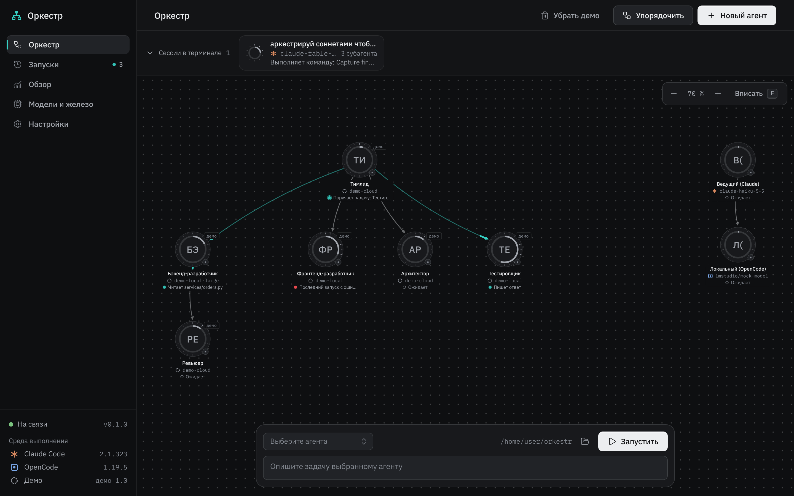
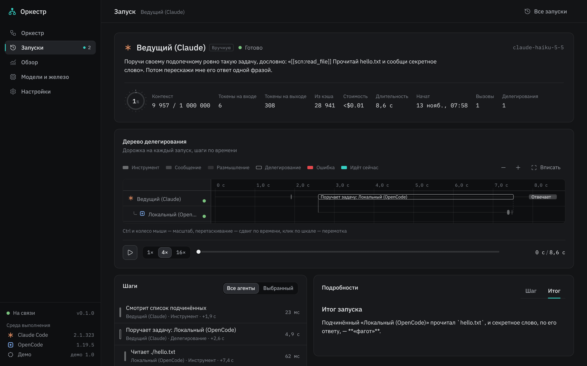

# Оркестр

Локальный веб-пульт для управления ИИ-агентами Claude Code и OpenCode и наблюдения за ними.

- Агенты расставляются на графе; связь «руководитель → подопечный» рисуется мышкой и действует сразу
- Пульт сам запускает агентов и даёт руководителям инструменты `list_subordinates`, `delegate`, `check_task` (MCP), поэтому агент Claude Code может поручить работу агенту OpenCode и наоборот
- При наведении на агента или модель видно заполненность контекста, модель, текущее занятие, токены и стоимость
- Каждый запуск показан как дерево делегирования на временной шкале, с воспроизведением
- Мониторинг CPU, памяти, видеокарт, LM Studio и llama.cpp
- Сессии Claude Code, запущенные в терминале, видны в режиме просмотра




## Установка и запуск (Linux)

Нужны Python 3.11+ и установленные `claude` и/или `opencode` в `PATH`.

```bash
python3 -m venv .venv
```

```bash
.venv/bin/pip install -e .
```

```bash
.venv/bin/python -m orkestr
```

Откройте http://127.0.0.1:8787. Параметры: `--port`, `--host`, `--db ПУТЬ`, `--demo` (демо-команда с имитацией работы, без обращения к моделям).

Пульт слушает только `127.0.0.1` и не имеет авторизации. Не открывайте его порт в сеть.

## Как пользоваться

1. «Новый агент» или двойной клик по полю. В панели справа задайте среду (Claude Code или OpenCode), модель, роль, папку проекта и права
2. Потяните от точки на краю узла к другому узлу, либо выберите узел, нажмите «Назначить подопечного» и кликните по цели. Циклы запрещены
3. Выберите агента, напишите задачу внизу, нажмите «Запустить» (Ctrl+Enter)
4. Следите за графом: по ребру бежит штрих, пока подопечный выполняет поручение. Подробности — в разделе «Запуски»

Связь, проведённая во время работы агента, сразу видна ему в `list_subordinates`. Агент, у которого на момент старта не было ни одного подопечного, получит инструменты делегирования со следующего запуска.

## Права агентов

| Уровень | Что разрешено |
| --- | --- |
| Только чтение | Чтение и поиск в папке проекта |
| Чтение и правки (по умолчанию) | Плюс создание и изменение файлов в папке проекта; оболочка выключена |
| Полная автономия | Любые команды без подтверждений (в Claude Code это режим `bypassPermissions`). Включается вручную для конкретного агента |

В OpenCode чтение внутри git-репозитория проекта не сужается до подпапки.

## Локальные модели

LM Studio (`127.0.0.1:1234`) и llama.cpp (`127.0.0.1:8080`) опрашиваются автоматически; другие серверы добавляются в «Модели и железо». Модели поднятого сервера появляются в списке моделей агентов OpenCode в виде `lmstudio/<модель>` или `llamacpp/<модель>` — пульт сам подставляет провайдера на время запуска и не трогает ваши конфиги.

## Подключение сессии из терминала к иерархии

«Настройки → Подключить сессию из терминала» даёт готовую команду вида:

```bash
claude mcp add --transport http orkestr http://127.0.0.1:8787/mcp/agent/<id агента>
```

После этого терминальная сессия может поручать задачи подопечным выбранного агента.

## Что проверено, а что нет

Проверено на настоящих инструментах (Claude Code 2.1.323, OpenCode 1.19.5):

- запуск, права, отмена, разбор потока событий обоих CLI
- делегирование Claude Code → OpenCode через MCP от начала до конца
- 385 автотестов: `.venv/bin/python -m pytest -q`

Не проверено вживую — в среде разработки не было этих программ и видеокарты:

- настоящие LM Studio и llama.cpp (разбор ответов написан по документации и проверен на имитаторах; OpenCode работал с имитатором OpenAI-совместимого сервера)
- `nvidia-smi` и датчики AMD/Intel (проверены на записанных образцах вывода)
- облачные провайдеры OpenCode с ключами, модели Claude кроме Haiku
- поведение, когда Claude Code не авторизован

Известные ограничения:

- llama.cpp не сообщает занятость контекста по слотам, виден только размер окна
- терминальные сессии OpenCode пока не отображаются (только Claude Code)
- стоимость считается по данным самих CLI; для терминальных сессий она неизвестна
- события субагентов внутри OpenCode (инструмент `task`) не разбираются

## Устройство

`orkestr/` — сервер на FastAPI: `store.py` (SQLite), `engine.py` (запуски и делегирование), `mcp_server.py`, `runtimes/` (адаптеры CLI), `probes/` (железо и серверы моделей), `watchers/` (терминальные сессии). `web/` — интерфейс без сборки на чистых ES-модулях. Контракт между частями: `docs/CONTRACT.md`, дизайн: `docs/DESIGN.md`, справка по интерфейсу: `web/GUIDE.md`.

## Благодарности

Дизайн сделан по методу **unslop** Дамира Соколовского ([@heydamir](https://x.com/heydamir)), лицензия CC BY 4.0; материалы лежат в `docs/design/unslop/`. Шрифты IBM Plex (SIL OFL), иконки Lucide (ISC).
